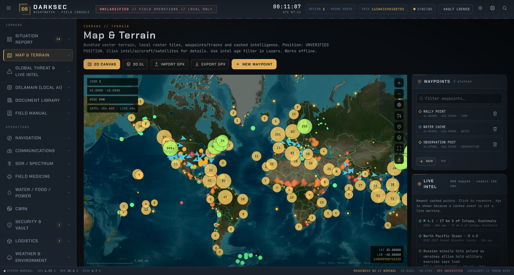
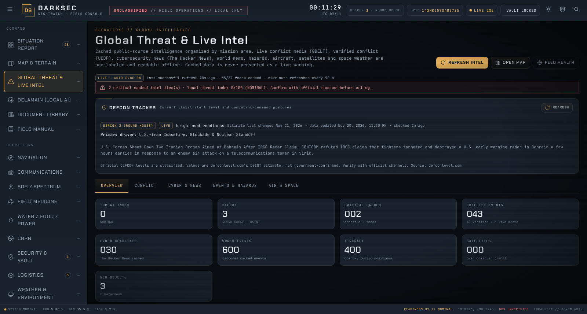
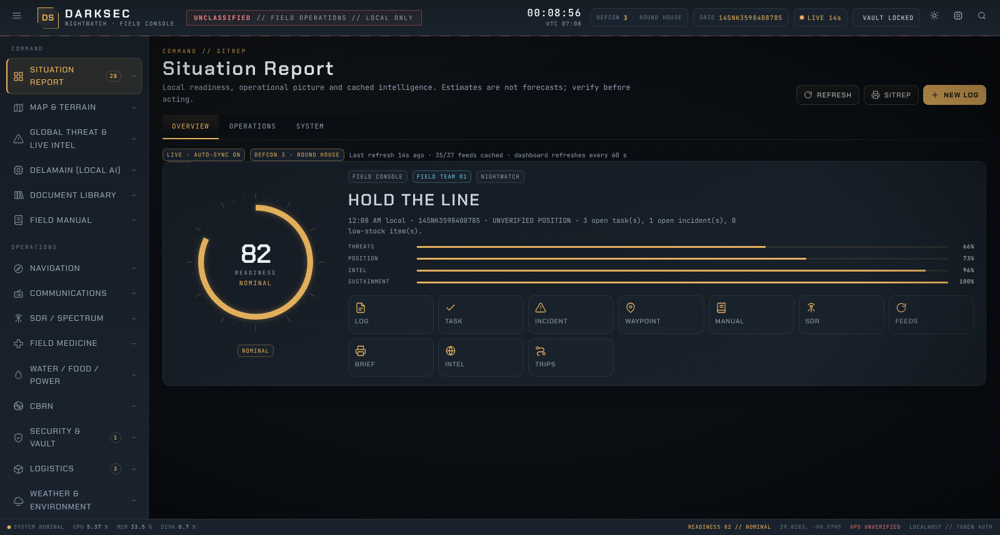
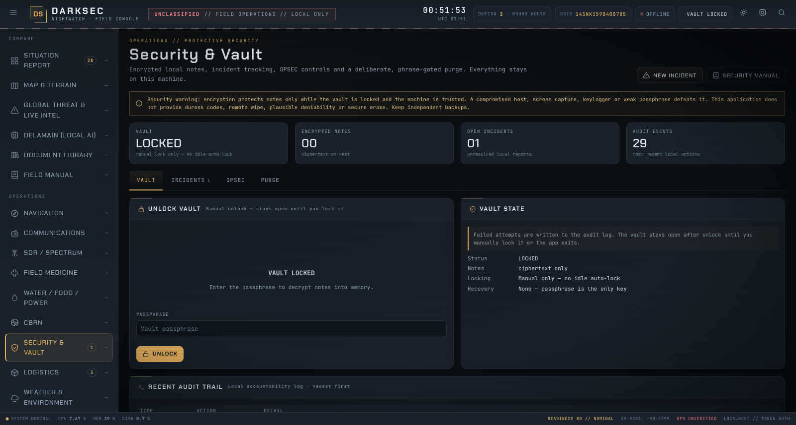
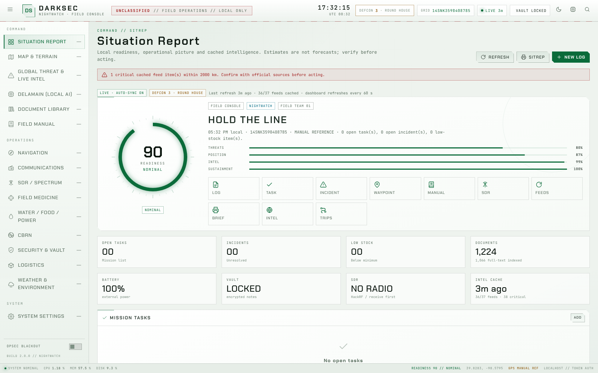

# DarkSec NIGHTWATCH


A local-only, offline-first survival field console. It runs a Python FastAPI
backend on `127.0.0.1`, serves a bundled single-page interface, and keeps all
operator data and hardware access on the machine.

The existing PDF library is preserved in place. Nothing in the document tree is
rewritten; indexing only records metadata and extracted text in a local SQLite
database.

> This is a planning and record-keeping tool, not a substitute for training,
> current official guidance, a clinician, a licensed radio operator, or a
> calibrated instrument. Read the safety notes inside each module. In a real
> emergency, contact local emergency services when possible.

## Screenshots

| World map | Focused map |
| --- | --- |
|  |  |

| DEFCON tracker | Situation report |
| --- | --- |
|  |  |

| Document library | Security & vault |
| --- | --- |
|  |  |

### Theme switching



Dark and light backgrounds are both supported. Light themes use soft, low-glare
palettes inspired by Catppuccin Latte, Rosé Pine Dawn, Solarized Light, GitHub
Light, Everforest Light and Tokyo Night Day: Daylight (soft cool), Paper (warm
rose), Solarized (cream), Cloud (neutral), Sand (parchment), Mint (sage),
Blueprint (cool blue), Lavender (orchid) and high-contrast light. Dark themes
include Nightwatch, Midnight, Blackout, Forest, Slate, Ocean, Ember, Plum and
high contrast. The sun/moon button in the top bar switches between your saved
dark and light themes. **Settings → Identity & display** sets the background
mode (Dark / Light / Follow system), both theme variants, and the accent colour.


### Global search


The magnifier in the top bar (or `/`) searches every operator record, the
full-text document library, field-manual guides, reference cards and radio
frequencies from one list. Matches open the owning view; a record also opens its
edit form, and a library result opens the document. `Ctrl+K` remains the command
palette.

## What is included

- **SITREP dashboard** — readiness indicator, almanac, feeds, tasks, incidents,
  recent logs, low stock and system state. Readiness is a transparent local
  estimate: threats weigh 40%, sustainment 30%, intel coverage 15% and position
  quality 15%. Critical cached headlines count as threat context, not as an
  intel-coverage failure.
- **Document library** — metadata + full-text search (SQLite FTS5) over the
  existing PDF/EPUB/etc. collection, with a bundled PDF.js reader. Scanned
  image-only PDFs are OCR'd on demand when `tesseract-ocr` and poppler are
  installed.
- **Global search** — the top-bar magnifier (or `/`) searches every operator
  record (logs, tasks, medical, inventory, caches, comms, trips, waypoints),
  the full document-library text, manual guides, reference cards and radio
  frequencies in one list. `Ctrl+K` remains the command palette.
- **Field manual** — 16 local Markdown guides, 40 quick-reference cards and 13
  equipment/event checklists.
- **Navigation** — WGS-84 / UTM / MGRS conversion, celestial almanac, magnetic
  declination (vendored WMM2025), resection, dead reckoning, tide estimate, GPS
  fix provenance, waypoints, GPX import/export, a bundled low-zoom world
  satellite overview (zooms 0–5) and downloadable offline tile packs.
- **Communications** — 29 bands, 60 common channels, phonetic alphabet,
  prowords, Q-codes, wilderness protocol, SOI plans and a radio log.
- **SDR / spectrum** — real HackRF/RTL detection, live sweep and waterfall,
  IQ capture, demodulation, recordings, ADS-B and a hard-gated transmit path.
- **Field medicine** — patient registry, triage board, vitals trends, clinical
  calculators and reference cards. Local records only.
- **Water / food / power** — treatment and consumption logs, stock levels,
  ration and power-system calculators.
- **CBRN** — dose-rate log, decay/fallout math, protective-action guidance and
  KI warnings.
- **Security & vault** — AES-256-GCM encrypted notes, incident log, OPSEC
  controls, audit trail and a phrase-gated purge.
- **Logistics** — mission tasks (including recurring tasks that roll forward
  when completed), cache register, offline trip plans and local check-in
  deadlines, a maintenance/expiry-due view, low-stock view, backups, JSON/CSV
  export and restore. Check-ins are not sent to an off-site contact.
- **Weather & environment** — manual observations, charts, a 3-day Open-Meteo
  forecast, hourly AQI trend, auto-synced NOAA/USGS/NWS/GDACS feeds with offline
  caching, plus nowcast calculators.
- **Field medicine** — patient registry, triage board, vitals trends and a
  medication administration log (dose, route, indication, who administered,
  reaction). Record-keeping only, not prescribing or diagnosis.
- **Global threat & live intel** — cached public live feeds (OpenSky aircraft,
  CelesTrak TLE/SGP4 satellites, USGS earthquakes, NOAA SWPC, GDACS/EONET,
  Safecast, Smithsonian volcano reports, world news and Open-Meteo), a local
  weighted threat index, solar/day-night state and live event logging into the
  mission log. The nearby critical-event radius is configurable in Settings
  (default 2000 km). Auto-sync pauses offline and in OPSEC mode.
- **Settings** — identity, position, grid format, radio limits, map tiles,
  light/dark appearance (Daylight, Paper, Solarized, Cloud, Sand, Mint,
  Blueprint, Lavender, high-contrast light and multiple dark themes, with a
  top-bar sun/moon toggle), feed source health/editing, vault custody,
  diagnostics and data custody.
- **Local AI assistant (Delamain)** — optional chat backed by a local Ollama
  instance. Detects installed models, can include cached intelligence context,
  and has no cloud dependency. Configure the endpoint and model in Settings.

## Install

Run the installer once. It installs the Python environment plus the document
tools Delamain needs to read PDFs and scanned pages:

```bash
./install.sh             # core runtime + PDF/OCR/DjVu tools
./install.sh --with-sdr  # also install optional radio/GPS tools
```

The installer supports apt, dnf, pacman, zypper, apk and Homebrew. It installs
poppler-utils (`pdftotext`, `pdftoppm`), `tesseract-ocr` with English data,
`djvulibre-bin`, `ffmpeg`, `sox`, `git`, Node.js/npm, a `.venv`, the Python
requirements and the desktop npm packages. It finishes by running
`tools/doctor.py --strict` and reports anything that is still missing.

```bash
python3 tools/doctor.py   # check dependencies at any time
```

Both launchers prefer `.venv` automatically. **Settings → Document library** shows
the same text-tool status (pdf text, pypdf, OCR, DjVu).

Prefer a manual setup? Install the packages listed in
[docs/INSTALL.md](docs/INSTALL.md), then:

```bash
python3 -m pip install -r requirements.txt
./launch-web.sh
```

The browser opens with a one-time token URL. The token is exchanged for an
HttpOnly cookie and removed from the address bar. To run without opening a
browser:

```bash
python3 -m darksec --port 8765
```

Optional flags:

```text
--no-index        do not start background library indexing
--token VALUE     fixed launch token (testing only)
--port N          fixed port (default: random free port)
--log-level ...   critical|error|warning|info|debug
```

### Local AI assistant (optional)

Delamain uses a locally running [Ollama](https://ollama.com) instance. The console
works fully without it; the assistant view will report **NO MODELS** until one is
available.

```bash
# install Ollama, then pull at least one model
ollama pull llama3.2
```

Set the endpoint (default `http://127.0.0.1:11434`) and model name in
**Settings → Assistant**. Only local endpoints are used; nothing is sent to a
cloud service. The assistant can include cached intelligence context when asked.

Delamain can also act on the local system when you ask it to: it can save an entry
to the mission log, save an encrypted vault note (vault must be unlocked), and
search or OCR the indexed document library. These tools are rate-limited server-side
(default 20 log entries/hour and 1000 total; 10 vault notes/hour and 200 total) so
a misbehaving model cannot fill the disk. Turn the tools off entirely in
**Settings → Assistant → Allow Delamain to save notes/logs**.

Latency notes:

- The configured model is preloaded when the assistant opens and kept in memory
  for 30 minutes (`assistant_keep_alive`), so the first message does not pay the
  cold-load cost.
- **Timeout (sec)** is the per-request Ollama read timeout. The chat view reports
  a stall only after that many seconds pass with no streamed activity, so the UI
  and backend timeouts stay aligned even if you raise it to 900s.
- Tool definitions cost a large chunk of prompt tokens on CPU. They are attached
  only when the message asks for live conditions, a library lookup, or a save
  action; disable **Load tools only when needed** to always send them.
- Retrieved library excerpts are injected only for manual/document questions.
  Keep the system prompt and context-token setting stable during a chat so
  Ollama can reuse its cached prompt prefix; changing them forces a full
  re-evaluation of the conversation.


### Desktop shell (Electron)

```bash
npm install        # once
./launch-desktop.sh
```

The Electron main process starts the Python backend itself, reads the JSON
handshake from stdout, and loads the console. Closing the window terminates the
backend. Set `DARKSEC_PYTHON` if your interpreter is not `python3`.

### LAN / mobile access (optional)

By default DarkSec binds to `127.0.0.1` only. To use a phone or tablet on the
same trusted network while the PC runs the console:

```bash
python3 -m darksec --lan
```

This binds to all interfaces, serves over HTTPS with an auto-generated
self-signed certificate, and prints a token URL. Open that URL on the phone,
accept the certificate warning, and the session cookie is set exactly as on
desktop. `--lan-ip ADDRESS` overrides the auto-detected address; `--port N`
still applies. OPSEC mode disables LAN access.

Do **not** expose this to the public internet. There is no rate limiting or
account system beyond the per-launch token; treat the LAN like a trusted
environment.

## Data locations

By default everything writable lives in `fielddata/` next to the application:

```text
fielddata/
  darksec.db          records, settings, audit, library index
  recordings/         SDR recordings and captures
  backups/            operator-data backups
  uploads/            imported files
  logs/
```

Set `DARKSEC_DATA` to relocate the whole writable tree (useful for a USB
stick). `DARKSEC_LIBRARY` can add extra document roots separated by `:`
(`;` on Windows).

The document library is read from `chembio/`, `comms/`, `engineering/`,
`hacking/`, `manuals/`, `medical/`, `prepper/`, `water_food/`, `maps/` and
`isos/`. The duplicate `Books/` tree is deliberately excluded.

### Offline map tiles

The app ships `maps/tiles/overview/` — a real low-zoom world satellite
overview (zooms 0–5) — and `maps/vector/world.geojson` for the dark vector
layer. Both work with no network.

For detail around your position, open **Map → Manage offline map**, choose a
radius or the current viewport and a maximum zoom. **Download the full zoom
stack** is enabled by default so zooming out uses the same provider instead of
switching to a different basemap. Tiles are validated before they are stored
under `maps/tiles/cache/<source>/z/x/y.ext`, so a provider error page can never
end up in the cache.

The map uses one source at a time: the active provider's exact tile, then that
same provider online, then an overzoomed parent tile from the same provider,
and only then the bundled overview. Cached tiles from unrelated providers are
never mixed into the same view. Missing high-zoom tiles therefore stay aligned
with roads, waypoints and intel instead of turning into a patchwork.

**Cache viewed areas automatically** in Settings → Offline maps is on by
default: after the map is idle for a few seconds it downloads the missing full
zoom stack for the current viewport while online. Cached tiles are skipped.
**Verify cache** in the offline-map dialog removes HTML error pages, partial
files and corrupt images (and is also checked whenever a tile is read).
**Clear offline tiles** removes downloaded tiles.

**Tile cache location** in Settings → Offline maps can point at a USB folder,
for example `/media/<user>/<drive>/DarkSec-Tiles`. Press **FIND USB** to list
mounted writable folders, **CHECK** to verify free space and permissions, then
**SAVE MAP**. Switching folders asks whether to **copy existing tiles**; the
copy runs in the background and the old cache is left in place until you
delete it. If the drive is unplugged the map falls back to other sources
instead of failing, and downloads report the write error.

#### MBTiles from a USB drive

Operator-supplied MBTiles archives are read **in place and read-only**, so a
multi-gigabyte regional map does not have to be copied into the app folder:

1. Plug in the drive and wait for it to mount.
2. Open **Settings → Offline maps → MBTiles path**.
3. Press **FIND ON USB**. The scanner looks in the data folder, `maps/`, your
   home folder and common mount points (`/media`, `/run/media`, `/mnt`,
   `/Volumes`, and `D:`–`Z:` on Windows).
4. Pick an archive, or point the path at a folder containing several
   `.mbtiles` files. Press **CHECK** to verify it.

Raster PNG/JPEG/WebP archives are supported on both map renderers, including
gzip-compressed tile blobs and both the standard MBTiles TMS row order and
non-standard `scheme=xyz` archives.

Vector PBF/MVT archives (for example an OpenMapTiles/MapTiler
`planet-latest.planet.mbtiles`) are supported by the **3D GL map**. The 2D
canvas cannot rasterise PBF tiles, so it tells you to open the 3D map instead.
OpenMapTiles-schema archives get the full offline style (land, water,
boundaries, roads, buildings); archives from tilemaker, tippecanoe or custom
pipelines get a generic fill/line/point style, so a single layer such as `osm`
is still visible instead of rendering black. Text labels are omitted because
no glyph pack is bundled. The GL map shows the archive's layer names, zoom
range and index status, and warns if no tiles render for the current view.
Keep the drive mounted while the map is in use; if it is removed the map falls
back to bundled and cached tiles.

To rebuild the bundled overview from a working provider (online, once):

```bash
PYTHONPATH=. python3 tools/build_overview.py --max-zoom 5
```

### Position and address lookup

Navigation distinguishes a saved GPS fix, manually entered coordinate and
address-geocoded reference. None is presented as live tracking; GPS age and
reported accuracy are shown where available. Settings can look up an address
through OpenStreetMap Nominatim only after an explicit click. The exact query is
sent to that public service, is not written to disk and may remain in memory for
up to 24 hours; lookup is blocked in OPSEC mode. Only selected coordinates are
saved. Geocoded points have no GPS accuracy or elevation guarantee; verify the
point against terrain and a paper map before relying on it.
© OpenStreetMap contributors.

Accepting a fresh phone fix updates the global grid/coordinate display and the
position used by navigation, the map, almanac and location-based intel. It also
queues nearby Safecast and Open-Meteo refreshes when auto-sync is enabled.

Phone GPS uses the normal mobile browser—no companion app. Put the phone and
computer on the same trusted Wi-Fi or, preferably, a private phone hotspot.
**Settings → Position → Phone GPS · Browser** starts a five-minute HTTPS page
bound only to the selected local IPv4 interface; the normal DarkSec API stays
loopback-only. Scan its QR with the phone camera, review the self-signed
certificate warning, and continue only on a network you trust and when the IP
matches the selected interface. Grant browser location permission and tap
**START GPS SHARING**. The desktop displays age/accuracy and requires an
explicit **ACCEPT FIX**; no position is saved before acceptance. A phone fix is
treated as current for 24 hours before it is flagged stale (GPS receiver fixes use a
6-hour limit).

The page has no third-party assets and makes no cloud requests. Its temporary
bearer token is removed from the address bar after load; location updates are
not logged or written by the HTTPS listener. Keep the browser open for updates.
The listener stops on timeout, OPSEC activation, manual stop, or app shutdown.
Do not bypass a certificate warning on public/shared Wi-Fi; a private hotspot
is the safer choice. The self-signed certificate is temporary and is not a
public identity proof. This uses the browser-geolocation pattern of the
[Hak5 Mobile2GPS Pager payload](https://github.com/ryanpohlner/mobile2gps),
implemented as a separate, restricted DarkSec listener.

The saved source, fix age and accuracy appear in the status bar on every view.
While a phone session is still open, **Navigation → GPS receiver → QUERY** can
read that live browser fix directly (labelled as phone browser data) and use it
as the saved position; otherwise it reads local gpsd. The SITREP export includes
the same source/age/accuracy line and warns when the fix is unverified or stale.

### Indexing

Metadata indexing is quick. Deep text extraction uses `pdftotext` when
available and falls back to `pypdf`; a large collection can take hours. The
index runs in the background and can be started or stopped from the Library
screen. `DARKSEC_NO_INDEX=1` or `--no-index` disables automatic indexing.

### Downloading the document library

**Settings → Document library → Document library bundle** can install the
packaged library from its GitHub release manifest. Build a split bundle with
`python3 tools/build_document_bundle.py`, upload the parts plus
`document-library.bundle.json` to a GitHub release, then press
**DOWNLOAD DOCUMENT LIBRARY**. The official release URL is preconfigured. See
[docs/DOCUMENT_LIBRARY_BUNDLE.md](docs/DOCUMENT_LIBRARY_BUNDLE.md).

## SDR notes

The SDR module calls the real tools on `PATH`:

- `hackrf_info`, `hackrf_sweep`, `hackrf_transfer`
- optionally `rtl_test`, `rtl_fm`, `dump1090`, `rtl_433`, `multimon-ng`,
  `direwolf`, `sox`, `ffmpeg`

No spectrum, recording or device status is fabricated. With no radio attached,
the module reports **NO DEVICE** and the sweep stream returns an honest error.

`hackrf_sweep` tunes in whole-MHz steps, so the requested sweep range is rounded
outward to the nearest MHz and the returned frame reports the actual range.
Gains are clamped and snapped to the hardware steps (LNA 8 dB, VGA 2 dB, TX VGA
1 dB). The NOAA APT decoder is explicitly experimental: use a 137 MHz polar
satellite pass, about 2.4 Msps, and expect skew — use a dedicated decoder for
operational imagery.

Transmit is disabled by default and requires all of the following:

1. Enable TX in Settings and record the legal attestation (type `I AM RESPONSIBLE`).
2. Pass the per-transmission confirmation (`TRANSMIT`) and attestation checkbox.
3. Use a frequency you are licensed or authorised to transmit on.

The application cannot verify your licence, antenna, filter or legal status.
You are responsible for every transmission. Prefer a dummy load for testing.

## Feeds

Public feeds auto-sync while online by default (10-minute base cadence, with
per-source minimums and conservative backoff). Change or disable this in
**System Settings → Intelligence feeds**. Set `DARKSEC_NO_SYNC=1` to disable
automatic sync entirely at launch. OPSEC blackout and offline status
pause outbound fetches; cached results remain readable with their source age.
Dashboard, Intel, Weather and CBRN views refresh their presentation while open.
Use **SYNC NOW** for a one-shot refresh even when automatic sync is disabled.

- USGS earthquakes
- NOAA SWPC Kp and R/S/G space-weather scales
- NWS active alerts
- GDACS disaster alerts and NASA EONET natural events
- RSOE EDIS global disaster events (severity-coded event list with enriched
  coordinates for the highest-priority events)
- Smithsonian/USGS volcanic activity
- Safecast community radiation measurements
- WHO general news RSS (not a dedicated outbreak-alert feed)
- ReliefWeb and BBC / Guardian / France24 / DW / Al Jazeera / Crisis Group news
- GDELT 2.0 live conflict event slices (media-derived, automated coding)
- UCDP Candidate Events (monthly verified, lags weeks)
- Open-Meteo weather and air quality
- OpenSky live aircraft public positions
- CelesTrak satellite TLEs (SGP4 propagation; the provider may intermittently
  reject anonymous requests)

Responses are cached locally. Freshness depends on each provider's cadence;
cached values show their age and remain available offline. Community radiation
reports can be very old and are not live monitoring or official warnings. Old
feeds or sources whose newest item is stale are flagged in the feed state, and
the map excludes stale point feeds rather than plotting historical snapshots as
if they were current.

### Global threat / live intelligence layer

The **Global Threat & Live Intel** view (`#/intel`) assembles a local threat
index from cached live events and adds live-source panels:

- **Threat index** — local weighted aggregation over cached sourced events
  (earthquakes, disaster alerts, public safety warnings), distance-weighted
  from the stored reference position when one is set. Bands: SEVERE / ELEVATED /
  GUARDED / NOMINAL. Display only; not a forecast.
- **Live aircraft** — public position snapshots from the OpenSky network,
  with altitude / speed / heading. Military traffic is often not published.
- **Satellite watch** — cached CelesTrak TLE set propagated with SGP4; shows
  overhead passes for the operator position.
- **Future pass planner** — next rises/peaks/sets above a chosen elevation from
  the cached TLE catalogue, with duration, peak azimuth and name/NORAD filtering
  for observation or SDR capture planning.
- **CBRN picture** — NOAA space-weather scales, nearby Safecast reports, local
  dosimetry log, Smithsonian/USGS volcano reports, NASA EONET hazards and
  Open-Meteo air quality. These are advisory public proxies, not a confirmed
  CBRN incident feed or substitute for calibrated instruments and official
  alerts.
- **Air quality** — Open-Meteo AQI snapshot.
- **Global live events** — cached events that carry coordinates (earthquakes),
  newest first, with a `LOG` shortcut that files an incident into the mission
  log.
- **Live news & safety feeds** — cached wire/public source cards with refresh.

Automatic sync state is available at `GET /api/sync/status`; `POST /api/sync/now`
requests a one-shot sync. Explicit full or per-feed refreshes are available
through `POST /api/intel/refresh` and `POST /api/feeds/refresh` (with an `id`).
Cached data remains available offline.

Sources are third-party public feeds; some optional modules depend on configured
API keys. The application does not operate or verify these sources and cannot
guarantee their availability or accuracy.

Conflict reporting is split into a live, media-derived layer (GDELT 2.0) and a
monthly verified layer (UCDP Candidate Events, which lags weeks), plus
conflict-relevant wire and humanitarian headlines (BBC, Al Jazeera, Guardian,
France24, ReliefWeb, Crisis Group). The map renders geolocated conflict events
as diamonds: orange for UCDP verified, amber for GDELT live. Both are clearly
labeled, can be imprecise, and are never presented as confirmed targeting data.

## Backup and restore

**Logistics → Operator Data** writes a JSON backup under
`fielddata/backups/`. Backups contain records, checklists and non-secret
settings. They do **not** contain PDFs or decrypted vault notes.

Restore has two modes. **Replace** swaps the operator tables and preserves
record IDs, so patient/vitals links survive. **Merge** adds records and remaps
patient IDs for linked vitals. Missing required fields are filled with safe
defaults and incomplete rows are skipped rather than aborting the restore. TX
enablement and attestation are deliberately preserved rather than restored.
Backups never contain PDFs or decrypted vault notes. Export JSON or CSV for
interchange; keep a copy on removable media.

## Program updates

**Settings → Program updates** checks the installation's git remote and
fast-forwards the program files from `origin`. It requires a real git checkout
with an `origin` remote; a detached HEAD still blocks the update.

Local work is preserved. Before updating, tracked edits are saved to
`fielddata/backups/pre-update-<timestamp>/` as `local-changes.patch` plus
copies of the modified files, then reapplied on top of the new code. If a local
edit conflicts with an upstream change, the updated tree is left clean (so
DarkSec still starts) and the patch and copies remain in the backup folder for
manual recovery. Untracked or ignored files that an incoming commit would
overwrite are moved into the same backup first.

Local commits ahead of the remote are not rewritten; push or reset them before
updating. Runtime data in `fielddata/` is ignored by git and is not touched.
Packaged/frozen builds cannot self-update. Restart DarkSec after an update so
the running process loads the new code.

## Security model and limits

- The API binds to `127.0.0.1` only.
- A random per-launch token is required; it is stored in an HttpOnly,
  SameSite=Strict cookie. Mutations require same-origin or the CSRF token.
- Vault notes use AES-256-GCM with PBKDF2-HMAC-SHA256 (600,000 iterations).
  The key exists only in process memory and is dropped on lock, timeout or
  shutdown.
- There is no recovery key, duress code, remote wipe, plausible deniability or
  secure erase. A compromised OS, keylogger, screen capture, memory forensics
  or weak passphrase defeats the vault.
- The vault does not encrypt ordinary records, logs, recordings or documents.
  Use full-disk encryption and physical security.
- Host-header and cross-origin checks are enforced; the server also sends CSP
  and related security headers.
- No telemetry is included.

## Legal and safety

Radio transmission, medical care, water treatment, electrical work, firearms,
pyrotechnics, CBRN response and aviation/navigation all carry legal and
physical risk. The calculators are estimates with stated assumptions; verify
inputs, units, local law and current protocols. Do not use this software as the
sole source for a life-safety decision.

## Development checks

```bash
python3 -m pip install -r requirements-dev.txt   # pytest, httpx, pyflakes
npm run check            # Electron/JS syntax + Python compile + offline self-check
npm run test             # API regression suite (uses a throwaway database)
npm run check:all        # both of the above
python3 tools/selfcheck.py   # parsers, schema, config and assistant sanitizer
node tools/check-js.mjs      # every ui/js module without starting a browser
```

The self-check and the pytest suite build throwaway databases; they never
touch `fielddata/` and do not require network access or Ollama. The pytest
fixtures live in `tests/conftest.py`; add API-level regression tests there when
changing a route contract.

Run the backend against a throwaway data directory while testing:

```bash
DARKSEC_DATA=/tmp/darksec-test PYTHONPATH=. \
  python3 -m darksec --port 8765 --token testtoken --no-index
```
