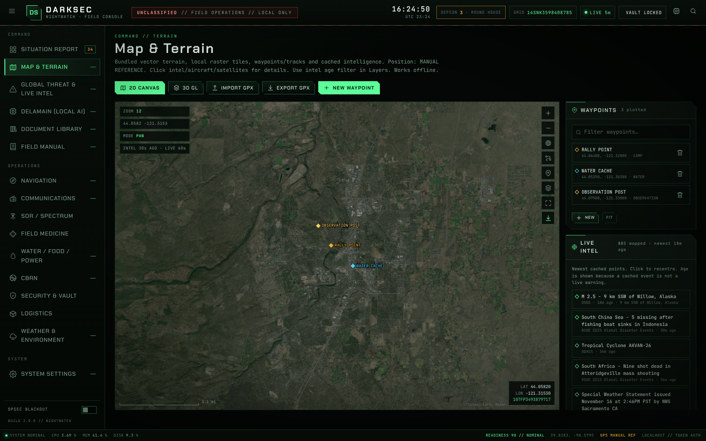
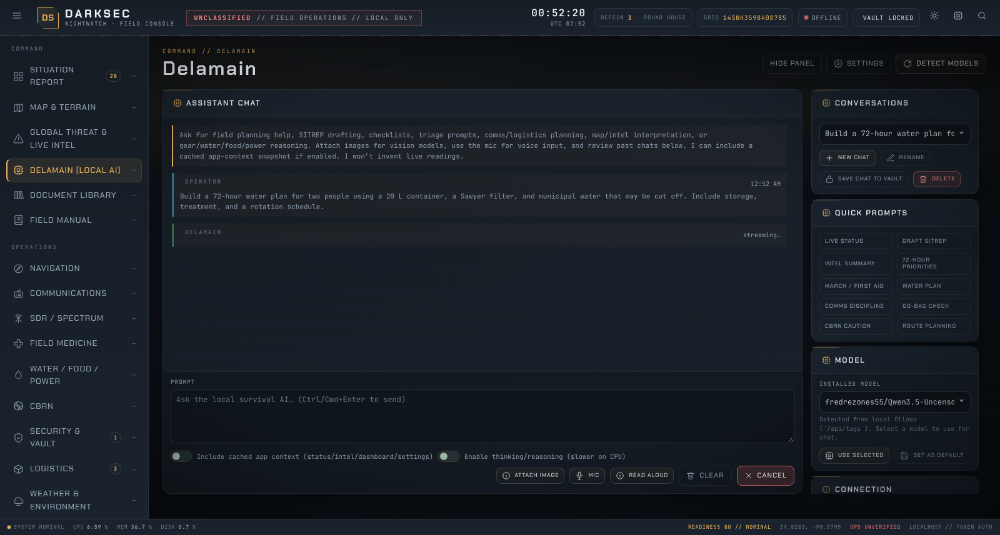
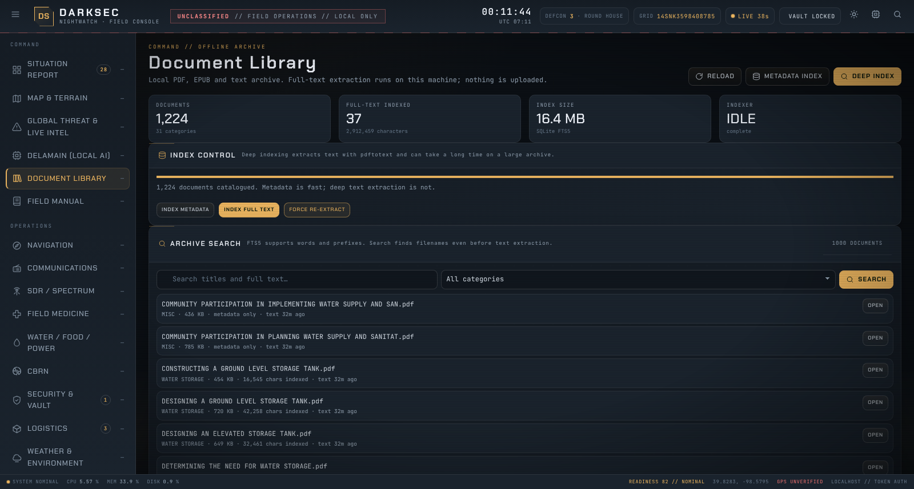
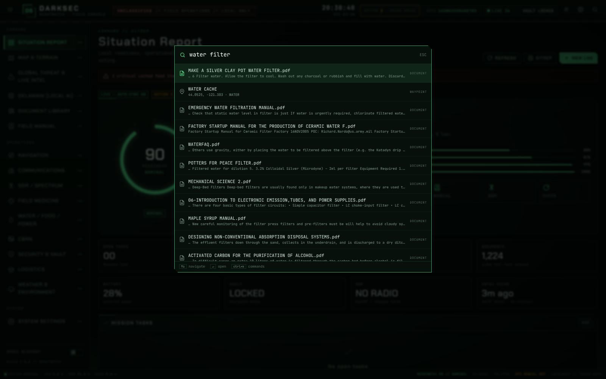
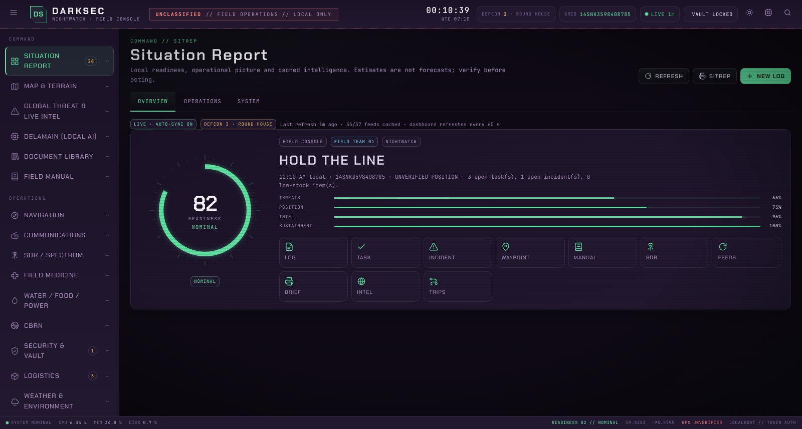
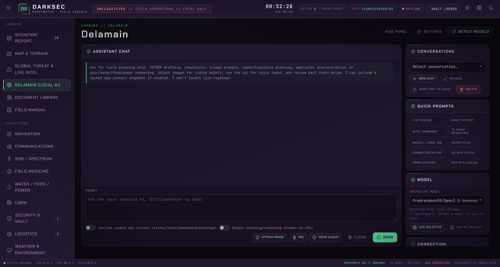

# DarkSec NIGHTWATCH


DarkSec NIGHTWATCH is a survival and intelligence console built for field operations including local LLM assistant. Combining global threat intelligence, navigation, SDR, communications, field medicine, CBRN references, resource management, encrypted storage, and an offline LLM assistant (Ollama model) with searchable knowledge library into one self-hosted platform. Built for preparedness

The document library you already have stays where it is. NIGHTWATCH indexes PDFs and other files in place and stores metadata/extracted text in a local SQLite database — it doesn't rewrite or reorganize your library.

> **Heads up:** This is a planning and record-keeping tool, not a replacement for training, current official guidance, a clinician, a licensed radio operator, or a calibrated instrument. Read the safety notes inside each module. If you're in a real emergency and can reach local emergency services, do that first.

## Screenshots

These were captured from a demo profile at 1600×1000 with sample data. No real operator position or vault contents are shown.

| World map | Focused map |
| --- | --- |
|  |  |

| DEFCON tracker | Situation report |
| --- | --- |
|  |  |

| Delamain (local AI) | Document library |
| --- | --- |
|  |  |

| Global search | Security & vault |
| --- | --- |
|  |  |

### Themes and color options

| Slate / Amber CRT (dark) | Plum / Green (dark) |
| --- | --- |
|  |  |

| Delamain in Plum / Green | Daylight (light) |
| --- | --- |
|  |  |

Both dark and light setups are supported. The light themes are meant to be easy on the eyes — soft, low-glare palettes inspired by Catppuccin Latte, Rosé Pine Dawn, Solarized Light, GitHub Light, Everforest Light, and Tokyo Night Day. Light options include Daylight, Paper, Solarized, Cloud, Sand, Mint, Blueprint, Lavender, and high-contrast light. Dark themes include Nightwatch, Midnight, Blackout, Forest, Slate, Ocean, Ember, Plum, and high contrast.

The sun/moon button in the top bar flips between your saved dark and light themes. You can dial in the details under **Settings → Identity & display**.

## What's inside

NIGHTWATCH is a lot of small, useful tools in one place. The goal isn't to be flashy — it's to have the stuff you actually need when you're offline, tired, or working with limited gear.

- **SITREP dashboard** — A quick read on readiness, almanac, feeds, tasks, incidents, recent logs, low stock, and system state. The readiness score is intentionally transparent: threats weigh 40%, sustainment 30%, intel coverage 15%, and position quality 15%. Critical cached headlines count as threat context, not an intel-coverage failure.
- **Document library** — Metadata + full-text search (SQLite FTS5) over your existing PDF/EPUB/etc. collection, with a bundled PDF.js reader. Scanned image-only PDFs can be OCR'd on demand when `tesseract-ocr` and poppler are installed.
- **Global search** — Hit the top-bar magnifier or `/` to search operator records, document text, manual guides, reference cards, and radio frequencies in one place. `Ctrl+K` still opens the command palette.
- **Field manual** — 16 local Markdown guides, 40 quick-reference cards, and 13 equipment/event checklists.
- **Navigation** — WGS-84 / UTM / MGRS conversion, celestial almanac, magnetic declination (vendored WMM2025), resection, dead reckoning, tide estimate, GPS fix provenance, waypoints, GPX import/export, a bundled low-zoom world satellite overview (zooms 0–5), and downloadable offline tile packs.
- **Communications** — 29 bands, 60 common channels, phonetic alphabet, prowords, Q-codes, wilderness protocol, SOI plans, and a radio log.
- **SDR / spectrum** — Real HackRF/RTL detection, live sweep and waterfall, IQ capture, demodulation, recordings, ADS-B, and a hard-gated transmit path.
- **Field medicine** — Patient registry, triage board, vitals trends, medication administration log, and clinical calculators/reference cards. Local records only — not prescribing or diagnosis.
- **Water / food / power** — Treatment and consumption logs, stock levels, ration and power-system calculators.
- **CBRN** — Dose-rate log, decay/fallout math, protective-action guidance, and KI warnings.
- **Security & vault** — AES-256-GCM encrypted notes, incident log, OPSEC controls, audit trail, and a phrase-gated purge.
- **Logistics** — Mission tasks (including recurring tasks that roll forward when completed), cache register, offline trip plans, local check-in deadlines, maintenance/expiry-due view, low-stock view, backups, JSON/CSV export, and restore. Check-ins are local — nothing gets sent to an off-site contact.
- **Weather & environment** — Manual observations, charts, a 3-day Open-Meteo forecast, hourly AQI trend, auto-synced NOAA/USGS/NWS/GDACS feeds with offline caching, and nowcast calculators.
- **Global threat & live intel** — Cached public feeds (OpenSky aircraft, CelesTrak TLE/SGP4 satellites, USGS earthquakes, NOAA SWPC, GDACS/EONET, Safecast, Smithsonian volcano reports, world news, Open-Meteo), a local weighted threat index, solar/day-night state, and live event logging into the mission log. The nearby critical-event radius is configurable in Settings (default 2000 km). Auto-sync pauses offline and in OPSEC mode.
- **Settings** — Identity, position, grid format, radio limits, map tiles, appearance, feed source health/editing, vault custody, diagnostics, and data custody.
- **Local AI assistant (Delamain)** — Optional chat backed by a local Ollama instance. It can detect installed models, include cached intelligence context, and run with no cloud dependency. Configure the endpoint and model in Settings.

## Install

The easiest way to get going is the installer. It sets up the Python environment and the document tools Delamain needs to read PDFs and scanned pages:

```bash
./install.sh             # core runtime + PDF/OCR/DjVu tools
./install.sh --with-sdr  # also install optional radio/GPS tools
```

If `./install.sh` does nothing, says **Permission denied**, or the checkout came from a ZIP/USB drive that lost executable bits or is mounted `noexec`, run it through bash:

```bash
bash install.sh
```

From a file manager, double-click **`install-gui.sh`** so the terminal stays open and you can actually read any errors. The installer needs an interactive terminal because `sudo` may ask for a password. If the tools are already installed and you don't want system packages, use `bash install.sh --no-system`. Progress and package-manager output go to `/tmp/darksec-install.log`.

The installer supports apt, dnf, pacman, zypper, apk, and Homebrew. It installs poppler-utils (`pdftotext`, `pdftoppm`), `tesseract-ocr` with English data, `djvulibre-bin`, `ffmpeg`, `sox`, `git`, Node.js/npm, a `.venv`, Python requirements, and desktop npm packages. It finishes by running `tools/doctor.py --strict` and tells you what's still missing.

```bash
python3 tools/doctor.py   # check dependencies at any time
```

Both launchers prefer `.venv` automatically. **Settings → Document library** shows the same text-tool status (pdf text, pypdf, OCR, DjVu).

### Manual setup

If you'd rather do it by hand, install the packages listed in [docs/INSTALL.md](docs/INSTALL.md), then:

```bash
python3 -m pip install -r requirements.txt
./launch-web.sh
```

The browser opens with a one-time token URL. The token gets exchanged for an HttpOnly cookie and removed from the address bar. To run without opening a browser:

```bash
python3 -m darksec --port 8765
```

Optional flags:

```text
--no-index        do not start background library indexing
--token VALUE     fixed launch token (testing only)
--port N          fixed port (default: random free port)
--log-level ...   critical|error|warning|info|debug
```

## Local AI assistant (optional)

Delamain uses a locally running [Ollama](https://ollama.com) instance. NIGHTWATCH works fine without it — the assistant view will just show **NO MODELS** until one is available.

```bash
# install Ollama, then pull at least one model
ollama pull llama3.2
```

Set the endpoint (default `http://127.0.0.1:11434`) and model name in **Settings → Assistant**. Only local endpoints are used; nothing gets sent to a cloud service.

**Personalities** — Settings → Assistant includes three editable starting personalities for Delamain (**Field standard**, **Dry wit**, **Mentor**). Pick one to change how it sounds and what it emphasizes. **EDIT** changes the selected personality, **NEW** adds another (up to 12), and **DELETE** removes one (at least one always stays). The selected personality's text is the system prompt sent to the model, and the hard safety/tool limits are present in every starting prompt. If you had a custom system prompt from an older install, it's kept as the first personality during upgrade.

Delamain can also take a few local actions when you ask it to: save an entry to the mission log, save an encrypted vault note (vault must be unlocked), and search or OCR the indexed document library. These tools are rate-limited server-side (default 20 log entries/hour and 1000 total; 10 vault notes/hour and 200 total) so a misbehaving model can't fill the disk. You can turn them off entirely in **Settings → Assistant → Allow Delamain to save notes/logs**.

A few latency notes, because they matter on slower hardware:

- The configured model is preloaded when the assistant opens and kept in memory for 30 minutes (`assistant_keep_alive`), so the first message doesn't pay the cold-load cost.
- **Timeout (sec)** is the per-request Ollama read timeout. The chat view reports a stall only after that many seconds pass with no streamed activity.
- Tool definitions cost a chunk of prompt tokens on CPU. They're attached only when the message asks for live conditions, a library lookup, or a save action; disable **Load tools only when needed** to always send them.
- Retrieved library excerpts are injected only for manual/document questions. Keep the system prompt and context-token setting stable during a chat so Ollama can reuse its cached prompt prefix.

## Desktop shell (Electron)

```bash
npm install        # once
./launch-desktop.sh
```

The Electron main process starts the Python backend, reads the JSON handshake from stdout, and loads the console. Closing the window shuts down the backend. Set `DARKSEC_PYTHON` if your interpreter isn't `python3`.

## LAN / mobile access (optional)

By default DarkSec binds to `127.0.0.1` only. If you want to use a phone or tablet on the same trusted network while the PC runs the console:

```bash
python3 -m darksec --lan
```

This binds to all interfaces over plain HTTP and prints a URL like `http://192.168.1.20:8765/`. On a trusted network, open that URL on the device and the session is created automatically — no token URL and no certificate warning. `--lan-ip ADDRESS` overrides the auto-detected address; `--port N` still applies. Use `--port 80` when DarkSec can bind privileged ports if you want `http://<ip>/` with no port. `--lan-tls` switches back to self-signed HTTPS.

From the desktop UI, **Settings → LAN / mobile access** starts the same listener at the configured LAN port (default **8080**) and shows a URL and QR code. **Easy access** is on by default: any device on the same private LAN can open the console without a token. Turn it off to require the printed token URL again. LAN ports and transport changes apply when saved.

**Save it as an app.** The console ships a web app manifest and home-screen icons, so **Add to Home Screen** on iOS and **Install app / Add to Home screen** on Android uses the DarkSec emblem, opens without browser chrome, and keeps the dark theme. On plain-HTTP LAN addresses Android treats it as a bookmark shortcut (service workers need a secure context); use `--lan-tls` for a full installable app on the phone.

Do **not** expose this to the public internet or run it on shared Wi-Fi. Easy access trusts every device on the LAN; there is no account system. OPSEC mode disables LAN access.

## Data locations

By default everything writable lives in `fielddata/` next to the application:

```text
fielddata/
  darksec.db          records, settings, audit, library index
  recordings/         SDR recordings and captures
  backups/            operator-data backups
  uploads/            imported files
  logs/
```

Set `DARKSEC_DATA` to relocate the whole writable tree (handy for a USB stick). `DARKSEC_LIBRARY` can add extra document roots separated by `:` (`;` on Windows).

The document library is read from `chembio/`, `comms/`, `engineering/`, `hacking/`, `manuals/`, `medical/`, `prepper/`, `water_food/`, `maps/`, and `isos/`. The duplicate `Books/` tree is deliberately excluded.

### Offline map tiles

The app ships `maps/tiles/overview/` — a real low-zoom world satellite overview (zooms 0–5) — and `maps/vector/world.geojson` for the dark vector layer. Both work with no network.

For detail around your position, open **Map → Manage offline map**, choose a radius or the current viewport and a maximum zoom. **Download the full zoom stack** is enabled by default so zooming out uses the same provider instead of switching to a different basemap. Tiles are validated before they're stored under `maps/tiles/cache/<source>/z/x/y.ext`, so a provider error page can't end up in the cache.

The map uses one source at a time: the active provider's exact tile, then that same provider online, then an overzoomed parent tile from the same provider, and only then the bundled overview. Cached tiles from unrelated providers are never mixed into the same view.

**Labels are a separate overlay.** The map draws Esri place and road label tiles above the basemap; they aren't part of the imagery/topo tile set. The offline download dialog has **Also download place & road labels**, on by default when the labels overlay is enabled. It roughly triples the tile count, so the estimate shows the label share before you start.

One pack may queue up to 150,000 tiles across every source in it. The cap only stops a mis-click from starting a continent-scale job; a 25 km radius at max zoom 16 fits comfortably. If labels push a pack over it, the dialog offers to download the basemap alone instead of refusing outright.

Tile serving is built to stay responsive on slow storage and slow networks. A small in-memory LRU serves recently used tiles without touching the SD card, recent misses are remembered for a few seconds, missing tiles are queued to background workers, and a tile request waits at most 0.75 s for a provider before painting a cached parent.

The 3D globe uses a starfield space background beyond Earth's limb. Toggle **Settings → Offline maps → Starfield space background** if you prefer a plain background.

Aircraft and satellites move continuously between data updates. The client dead-reckons positions every second from the last reported speed and heading; satellite ground velocity comes from local SGP4 propagation. A lightweight `/api/map/moving` snapshot refreshes them every 20 seconds without re-fetching the full intel picture.

**Cache viewed areas automatically** in Settings → Offline maps is on by default: after the map is idle for a few seconds it downloads the missing full zoom stack for the current viewport while online. **Verify cache** removes HTML error pages, partial files, and corrupt images. **Clear offline tiles** removes downloaded tiles.

**Tile cache location** in Settings → Offline maps can point at a USB folder, for example `/media/<user>/<drive>/DarkSec-Tiles`. Press **FIND USB** to list mounted writable folders, **CHECK** to verify free space and permissions, then **SAVE MAP**. Switching folders asks whether to copy existing tiles; the copy runs in the background and the old cache is left in place until you delete it.

The same panel includes cache maintenance: total/per-source tile counts, free space, **Verify & repair**, per-source or **Clear all tiles**, a shortcut to **Download offline pack**, and **Transfer to USB**.

Starting a pack closes the selection dialog and continues in the background. **Map → Downloads** shows live progress, counts, per-tile log, and a **Cancel** button. Finished jobs stay in the panel briefly with their logs.

### MBTiles and loose tiles

Operator-supplied MBTiles archives are read **in place and read-only**, so a multi-gigabyte regional map doesn't have to be copied into the app folder:

1. Plug in the drive and wait for it to mount.
2. Open **Settings → Offline maps → MBTiles path**.
3. Press **FIND ON USB**. The scanner looks in common mount locations, and on Windows `D:`–`Z:`.
4. Pick an archive, or point the path at a folder containing several `.mbtiles` files. Press **CHECK** to verify it. **DIAGNOSE** produces a copyable report if the drive isn't visible.

Archives whose extension is `.pbf` or `.mvt` but whose contents begin with `SQLite format 3` are treated as MBTiles too. A folder of loose vector tiles in `{z}/{x}/{y}.pbf` (or `.mvt`) form is also accepted, either directly or under a `tiles/` subfolder. Loose `{z}/{x}/{y}.png|jpg|webp` trees work as raster basemaps on both renderers.

If the drive is re-plugged under a different label or user path, DarkSec looks for an archive or tile folder with the same name on the current mounts and uses it automatically. Save the new path in Settings to make it permanent.

Raster PNG/JPEG/WebP archives are supported on both map renderers. Vector PBF/MVT archives are supported by the **3D GL map**; the 2D canvas can't rasterise PBF tiles, so it tells you to open the 3D map instead. OpenMapTiles-schema archives get the full offline style; archives from tilemaker, tippecanoe, or custom pipelines get a generic fill/line/point style. Keep the drive mounted while the map is in use; if it's removed, the map falls back to bundled and cached tiles.

To rebuild the bundled overview from a working provider (online, once):

```bash
PYTHONPATH=. python3 tools/build_overview.py --max-zoom 5
```

### Position and address lookup

Navigation distinguishes a saved GPS fix, manually entered coordinate, and address-geocoded reference. None of them are presented as live tracking; GPS age and reported accuracy are shown where available.

Settings can look up an address through OpenStreetMap Nominatim only after an explicit click. The exact query is sent to that public service, is not written to disk, and may remain in memory for up to 24 hours; lookup is blocked in OPSEC mode. Only selected coordinates are saved. Geocoded points have no GPS accuracy or elevation guarantee — verify the point against terrain and a paper map before relying on it. © OpenStreetMap contributors.

Accepting a fresh phone fix updates the global grid/coordinate display and the position used by navigation, the map, almanac, and location-based intel. It also queues nearby Safecast and Open-Meteo refreshes when auto-sync is enabled.

Phone GPS uses the normal mobile browser — no companion app. Put the phone and computer on the same trusted Wi-Fi or, preferably, a private phone hotspot. **Settings → Position → Phone GPS · Browser** starts a five-minute HTTPS page bound only to the selected local IPv4 interface. Scan its QR with the phone camera, review the self-signed certificate warning, and continue only on a network you trust. Grant browser location permission and tap **START GPS SHARING**. The desktop displays age/accuracy and requires an explicit **ACCEPT FIX**; no position is saved before acceptance.

The page has no third-party assets and makes no cloud requests. Keep the browser open for updates. The listener stops on timeout, OPSEC activation, manual stop, or app shutdown. Do not bypass a certificate warning on public/shared Wi-Fi; a private hotspot is the safer choice.

## Indexing

Metadata indexing is quick. Deep text extraction uses `pdftotext` when available and falls back to `pypdf`; a large collection can take hours. The index runs in the background and can be started or stopped from the Library screen. `DARKSEC_NO_INDEX=1` or `--no-index` disables automatic indexing.

## Downloading the document library

**Settings → Document library → Document library bundle** can install the packaged library from its GitHub release manifest. Build a split bundle with `python3 tools/build_document_bundle.py`, upload the parts plus `document-library.bundle.json` to a GitHub release, then press **DOWNLOAD DOCUMENT LIBRARY**. The official release URL is preconfigured. See [docs/DOCUMENT_LIBRARY_BUNDLE.md](docs/DOCUMENT_LIBRARY_BUNDLE.md).

## SDR notes

The SDR module calls the real tools on `PATH`:

- `hackrf_info`, `hackrf_sweep`, `hackrf_transfer`
- optionally `rtl_test`, `rtl_fm`, `dump1090`, `rtl_433`, `multimon-ng`, `direwolf`, `sox`, `ffmpeg`

No spectrum, recording, or device status is fabricated. With no radio attached, the module reports **NO DEVICE** and the sweep stream returns an honest error.

`hackrf_sweep` tunes in whole-MHz steps, so the requested sweep range is rounded outward to the nearest MHz and the returned frame reports the actual range. Gains are clamped and snapped to hardware steps (LNA 8 dB, VGA 2 dB, TX VGA 1 dB). The NOAA APT decoder is explicitly experimental.

DarkSec drives HackRF, RTL-SDR, and network `rtl_tcp` receivers directly, with a live spectrum/waterfall cockpit, click-to-tune VFO, live audio, wideband scan, IQ capture, demodulation, recordings, and a gated HackRF transmit path. A WebSDR/KiwiSDR panel gives operators without a radio a curated public receiver list and opens the receiver tuned inside DarkSec. See [docs/SDR.md](docs/SDR.md) for hardware setup, uConsole USB-A/GPIO details, Raspberry Pi power advice, `rtl_tcp` sharing, and WebSDR etiquette.

Spotted aircraft are kept when the receiver is stopped: the ADS-B panel shows the last table (`LAST SPOTTED`) from the local `adsb_spotted` history (7 days, up to 2,000 aircraft) instead of going blank, and **SAVE TO VAULT** writes it to an encrypted vault note.

Live audio and the spectrum cockpit use a WebSocket. The server needs the `websockets` package (installed by `./install.sh`, listed in `requirements.txt`). If the console log says `No supported WebSocket library detected`, install it with the same Python that starts DarkSec and restart:

```bash
.venv/bin/python -m pip install websockets      # or: pip install 'uvicorn[standard]'
```

Without it the rest of the console still works; the SDR panel disables **PLAY** and shows the exact command instead of failing silently.

### Transmit safety

Transmit is disabled by default and requires all of the following:

1. Enable TX in Settings and record the legal attestation (type `I AM RESPONSIBLE`).
2. Pass the per-transmission confirmation (`TRANSMIT`) and attestation checkbox.
3. Use a frequency you are licensed or authorised to transmit on.

The application cannot verify your licence, antenna, filter, or legal status. You are responsible for every transmission. Prefer a dummy load for testing.

## Feeds

Public feeds auto-sync while online by default (10-minute base cadence, with per-source minimums and conservative backoff). Change or disable this in **System Settings → Intelligence feeds**. Set `DARKSEC_NO_SYNC=1` to disable automatic sync entirely at launch. OPSEC blackout and offline status pause outbound fetches; cached results remain readable with their source age.

Current feed sources include:

- USGS earthquakes
- NOAA SWPC Kp and R/S/G space-weather scales
- NWS active alerts
- GDACS disaster alerts and NASA EONET natural events
- RSOE EDIS global disaster events
- Smithsonian/USGS volcanic activity
- Safecast community radiation measurements
- WHO general news RSS (not a dedicated outbreak-alert feed)
- ReliefWeb and BBC / Guardian / France24 / DW / Al Jazeera / Crisis Group news
- GDELT 2.0 live conflict event slices (media-derived, automated coding)
- UCDP Candidate Events (monthly verified, lags weeks)
- Open-Meteo weather and air quality
- OpenSky live aircraft public positions
- CelesTrak satellite TLEs (SGP4 propagation)

Responses are cached locally. Freshness depends on each provider's cadence; cached values show their age and remain available offline. Community radiation reports can be very old and are not live monitoring or official warnings.

Conflict reporting is split into a live, media-derived layer (GDELT 2.0) and a monthly verified layer (UCDP Candidate Events, which lags weeks), plus conflict-relevant wire and humanitarian headlines. The map renders geolocated conflict events as diamonds: orange for UCDP verified, amber for GDELT live. Both are clearly labeled, can be imprecise, and are never presented as confirmed targeting data.

Sources are third-party public feeds; some optional modules depend on configured API keys. The application does not operate or verify these sources and cannot guarantee their availability or accuracy.

## Backup and restore

**Logistics → Operator Data** writes a JSON backup under `fielddata/backups/`. Backups contain records, checklists, and non-secret settings. They do **not** contain PDFs or decrypted vault notes.

Restore has two modes. **Replace** swaps the operator tables and preserves record IDs, so patient/vitals links survive. **Merge** adds records and remaps patient IDs for linked vitals. Missing required fields are filled with safe defaults and incomplete rows are skipped rather than aborting the restore. TX enablement and attestation are deliberately preserved rather than restored.

Export JSON or CSV for interchange; keep a copy on removable media.

## Program updates

**Settings → Program updates** checks the installation's git remote and fast-forwards the program files from `origin`. It requires a real git checkout with an `origin` remote.

Local work is preserved. Before updating, tracked edits are saved to `fielddata/backups/pre-update-<timestamp>/` as `local-changes.patch` plus copies of the modified files, then reapplied on top of the new code. If a local edit conflicts with an upstream change, the updated tree is left clean and the patch/copies remain in the backup folder for manual recovery.

Local commits ahead of the remote are not rewritten; push or reset them before updating. Runtime data in `fielddata/` is ignored by git and is not touched. Packaged/frozen builds cannot self-update. Restart DarkSec after an update so the running process loads the new code.

## Security model and limits

I want to be plain about what NIGHTWATCH does and does not protect you from.

- The API binds to `127.0.0.1` only by default.
- Loopback/desktop access uses a random per-launch token stored in an HttpOnly cookie. Mutations require same-origin or the CSRF token.
- Optional LAN **easy access** deliberately bypasses the token for clients on private/link-local addresses when LAN access is enabled. It's meant for a trusted home/field network only; turn it off to require the token URL.
- Vault notes use AES-256-GCM with PBKDF2-HMAC-SHA256 (600,000 iterations). The key exists only in process memory and is dropped on lock, timeout, or shutdown.
- There is no recovery key, duress code, remote wipe, plausible deniability, or secure erase. A compromised OS, keylogger, screen capture, memory forensics, or weak passphrase defeats the vault.
- The vault does not encrypt ordinary records, logs, recordings, or documents. Use full-disk encryption and physical security.
- Host-header and cross-origin checks are enforced; the server also sends CSP and related security headers.
- No telemetry is included.

## Legal and safety

Radio transmission, medical care, water treatment, electrical work, firearms, pyrotechnics, CBRN response, and aviation/navigation all carry legal and physical risk. The calculators are estimates with stated assumptions; verify inputs, units, local law, and current protocols. Don't use this software as the sole source for a life-safety decision.

## Development checks

```bash
python3 -m pip install -r requirements-dev.txt   # pytest, httpx, pyflakes
npm run check            # Electron/JS syntax + Python compile + offline self-check
npm run test             # API regression suite (uses a throwaway database)
npm run check:all        # both of the above
python3 tools/selfcheck.py   # parsers, schema, config and assistant sanitizer
node tools/check-js.mjs      # every ui/js module without starting a browser
```

The self-check and pytest suite build throwaway databases; they never touch `fielddata/` and do not require network access or Ollama. Add API-level regression tests in `tests/test_api.py` or the matching `tests/test_*.py` when changing behavior.

Run the backend against a throwaway data directory while testing:

```bash
DARKSEC_DATA=/tmp/darksec-test PYTHONPATH=. \
  python3 -m darksec --port 8765 --token testtoken --no-index
```
